Almurut II
==========

[](https://github.com/toksaitov/ttsky26e-almurut2/actions/workflows/gds.yaml) [](https://github.com/toksaitov/ttsky26e-almurut2/actions/workflows/test.yaml) [](https://github.com/toksaitov/ttsky26e-almurut2/actions/workflows/docs.yaml)

<p align="center">
  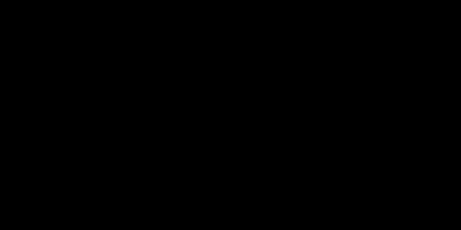
</p>

Almurut II is a 32-bit teaching computer with its own instruction set and an AI accelerator, built from the chip to the operating system. The chip is on the Tiny Tapeout shuttle TTSKY26e. Around it stand an emulator, an assembler, a C compiler, and the kernel Rach2 with a shell, utilities, and a showcase of programs.

It was made to teach computer organization, compilers, and operating systems, and it is the successor of the 8-bit Almurut I. A student can read every layer of it: the instruction that trains a neuron, the gates that run it, the assembler that encodes it, and the kernel that shares it between processes.

<p align="center">
  <a href="https://toksaitov.github.io/ttsky26e-almurut2/">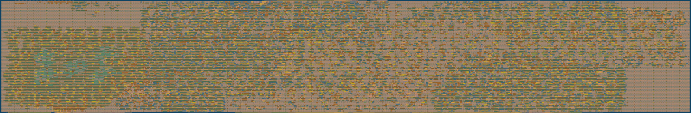</a>
  <br>
  <sub>The layout of the chip, 1.38 mm by 0.23 mm, as its build draws it.</sub>
</p>

[The Showcase](#the-showcase) · [Try It](#try-it) · [How It Works](#how-it-works) · [The AI Accelerator](#the-ai-accelerator) · [The Instruction Set](#the-instruction-set) · [The Chip](#the-chip) · [The Bus](#the-bus) · [The Software](#the-software) · [How It Is Checked](#how-it-is-checked) · [Building](#building) · [The Boards](#the-boards) · [The Platform](#the-platform) · [License](#license)

## At a Glance

| Part | In short |
| --- | --- |
| **AI accelerator** | Twelve weights and twelve inputs stay on the chip. One instruction runs a layer of a small neural network, and one more trains it. |
| **CPU** | 32 bits, 13 registers, 69 opcodes in one format of 4 bytes, an instruction cache of 32 words |
| **System** | Kernel and user mode, interrupts, seven exceptions, virtual memory with two levels of page tables, 4 GB of physical addresses |
| **Chip** | SKY130, 16 tiles of Tiny Tapeout, 11,243 logic cells, 12.5 MHz |
| **Software** | An emulator, an assembler, a C compiler, the kernel Rach2 with a shell and a file system, ten showcase programs and a game |
| **Boards** | The Tiny Tapeout demo board, and an FPGA bench of a DE10-Lite with a Raspberry Pi Pico |
| **Debugging** | The CPU stops between two instructions and runs them one at a time, and three wires show every register |

## The Showcase

The disk of the machine has programs that show what it can do, and each one explains itself on the screen. `tour` at the shell runs ten of them one after another, about eight minutes with nobody at the button. The pictures below are the screen of the machine, 128 by 64 pixels, recorded frame by frame from that run.

<p align="center">
  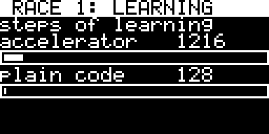 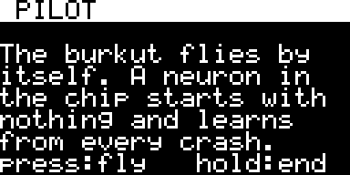
</p>

* **`race`**: the AI accelerator against plain code on the same job. Here it learns 10 times faster and answers 1.4 times faster, with the same answers.
* **`pilot`**: a neuron in the chip starts with nothing and learns to fly the burkut from every crash. Here its flight 14 passes 19 pillars.

<p align="center">
  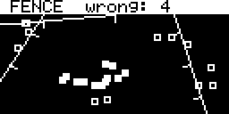 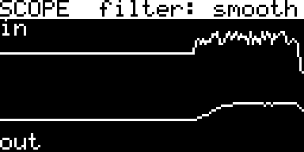
</p>

* **`fence`**: three neurons, each with a line, learn to keep the sheep inside and the wolves outside.
* **`scope`**: a noisy signal comes in at the top, and twelve numbers in the chip clean it, with one instruction for every sample.

<p align="center">
  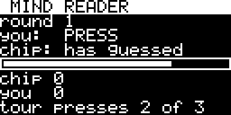 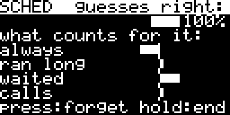
</p>

* **`guess`**: the chip learns how a person presses the button and guesses the next press. A coin is right half of the time, and the chip does better.
* **`sched`**: a neuron inside the kernel guesses whether a program will give up its turn early, and learns from every turn. Here about nine guesses of ten are right.

<p align="center">
  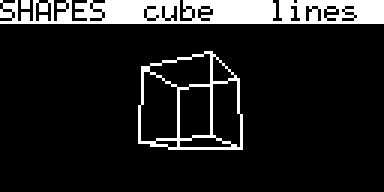 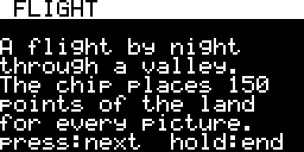
</p>

* **`shapes`**: a cube, a yurt, and a burkut turn in space, as lines and with filled sides. For every corner the chip does the nine multiplications of the turn in one instruction.
* **`flight`**: a flight by night through a valley. The chip places 150 points of the land for every picture.

<p align="center">
  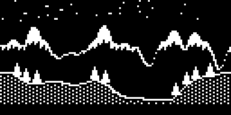 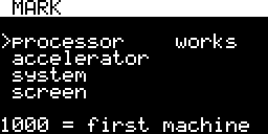
</p>

* **`film`**: a day in the high mountains, a minute long, of pictures and 3D models together.
* **`mark`**: the benchmark. Four kinds of work with checked answers give one score, where 1000 points are the first machine.

The disk also has `burkut`, the game that `pilot` plays, for a person at the button: a press is a beat of the wings between pillars of rock. The sources are in [asc2-demos/](asc2-demos), and [asc2-demos/Readme.md](asc2-demos/Readme.md) tells how the programs are made and what the board measured.

## Try It

The whole computer runs in the emulator. Make, a C compiler, and ncurses are enough (see [Building](#building)):

```bash
git clone https://github.com/toksaitov/asc2-project
cd asc2-project/asc2-rach2 && make
cd ../asc2-emulated && make
./asc -d ../asc2-rach2/build/disk.img ../asc2-rach2/build/rach2.bin
```

The kernel boots from the disk and starts its shell:

```
Rach2 for Almurut II
192 KB RAM, 176 free
Welcome to Almurut II
a 32-bit computer and
its AI accelerator.
Type tour for a show,
ls lists the programs
$ echo hello > note
$ cat note
hello
$
```

The emulator draws the CPU, the console, and the memory in a terminal, and `ctrl+z` pauses it to run one instruction at a time. The pictures of the showcase go to the screen of the board; `make` in [asc2-pictures/](asc2-pictures) records that screen from the emulator, which is how the pictures of the showcase were made.

## How It Works

<p align="center">
  <picture>
    <source media="(prefers-color-scheme: dark)" srcset="asc2-pictures/system-dark.svg">
    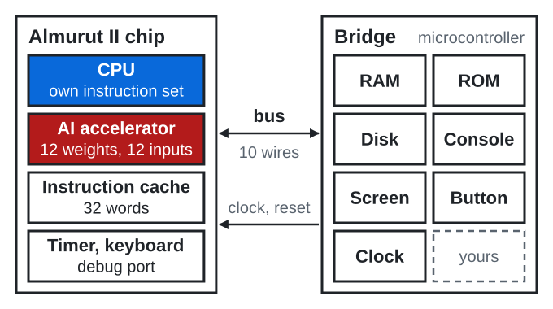
  </picture>
</p>

The computer has two parts. The chip holds the CPU with its instruction cache, the AI accelerator, an interrupt controller, a timer, and a keyboard controller. A microcontroller beside the chip is its bridge to memory, storage, and various peripherals: it serves the RAM, the boot ROM, a console, a disk, a clock, a screen, and a button over a narrow bus of the chip's own design.

The devices of the bridge are firmware, so the same chip can use any screen, disk, or device that the bridge supports, and a new device needs no new chip. On the Tiny Tapeout demo board the bridge is the board's RP2350B. On the bench it is a Raspberry Pi Pico beside a DE10-Lite board with the chip in its FPGA.

The bridge also drives the clock and the reset, so it can hold the CPU between two instructions, run them one at a time, and read every register through the debug port. With a button and a small screen on the board, the bridge becomes a debugger that shows each step. A kernel that wants its registers private can lock the port until the next reset.

## The AI Accelerator

<p align="center">
  <picture>
    <source media="(prefers-color-scheme: dark)" srcset="asc2-pictures/accelerator-dark.svg">
    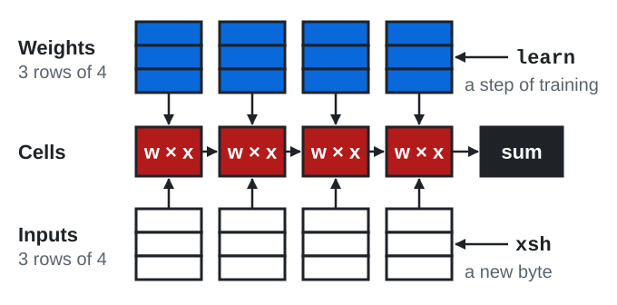
  </picture>
</p>

The accelerator keeps twelve weights and twelve inputs on the chip, a signed byte each, in three rows of four. A row of four cells multiplies a weight by an input in each cell and adds the products up, the step at the heart of a neural network. The cells take one row at a time: eight clocks to multiply, then the sums move to the right. The weights stay in the chip from one instruction to the next, so a small network or a filter lives there whole and does not cross the bus for every use.

| Instruction | What it does | What it is for |
| --- | --- | --- |
| `dotv rd` | Adds all twelve products to `rd` and sets the flags by the sum | A neuron of twelve inputs; a jump on its sign is a prediction |
| `dotm rd` | Adds the products of each row to a register of its own | A layer of three neurons at once; a matrix times a vector |
| `learn ra` | Moves every weight by its input times an error, a byte of `ra` for a row | A step of training in place |
| `xsh ra` | Moves the inputs on by one cell and takes a new byte | A filter over a stream; a history of events |
| `dot4 ra rb rd` | Multiplies the four bytes of `ra` by those of `rb` and adds the products to `rd` | A neuron whose weights live in ordinary registers |
| `ssat rd`, `usat rd` | Holds `rd` within a signed byte, or within 0 to 127 | The output of one layer as the input of the next; `usat` is the rectified linear unit |
| `popcnt ra rd` | Counts the bits of `ra` that are set | Networks with weights of one bit: 32 inputs in one instruction |

A neuron with its training is ten instructions. This is the whole neuron of `pilot`, from [asc2-demos/pilot_asm.s](asc2-demos/pilot_asm.s):

```asm
# int pilot_guess(unsigned int inputs)
pilot_guess:
    lr 0(sp) r0
    mov r0 x0
    li 0x0 r0
    dotv r0
    ret

# void pilot_learn(unsigned int inputs, unsigned int error)
pilot_learn:
    lr 0(sp) r0
    mov r0 x0
    lr 4(sp) r0
    learn r0
    ret
```

The board measured six small jobs, each written for the plain chip, for the chip with its instruction cache, and for the cache with the accelerator. Each bar is measured against the same job on the same chip with the cache off and without the accelerator, on the FPGA board at 12.5 MHz. The accelerator pays most where the work stays in the chip: a step of learning runs 38.8 times faster, in 65 microseconds in place of 2,535.

<p align="center">
  <picture>
    <source media="(prefers-color-scheme: dark)" srcset="asc2-pictures/gain-dark.svg">
    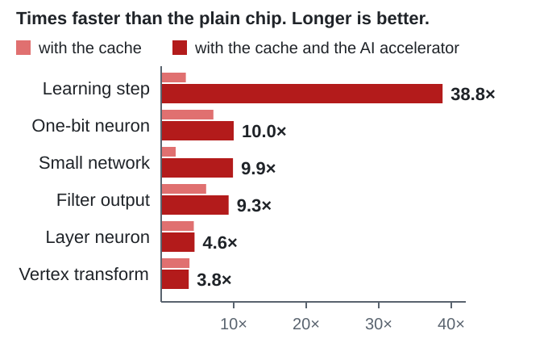
  </picture>
</p>

The kernel uses the accelerator itself: a small network in its scheduler guesses whether a process will sleep before its turn ends. Every process has its own set of weights and inputs, which the kernel swaps only when another process asks for them, as kernels of the PC do with the registers of the floating-point unit. [asc2-kb/array-design.md](asc2-kb/array-design.md) has the design, the measurements, and the sizes of the variants that were laid out.

## The Instruction Set

<p align="center">
  <picture>
    <source media="(prefers-color-scheme: dark)" srcset="asc2-pictures/instruction-dark.svg">
    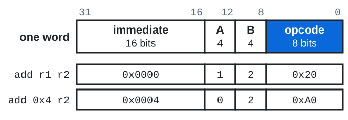
  </picture>
</p>

Every instruction is one word of 32 bits: an opcode, two register numbers, and an immediate value of 16 bits. Bit 7 of the opcode selects the form that takes the immediate value in place of register A, so `add r1 r2` has the opcode 0x20 and `add 0x4 r2` has 0xA0. The instruction set is the machine's own, shaped around ideas that students meet in x86 and ARM courses: a visible stack, explicit flags, interrupts and exceptions, kernel and user mode, and paging. Assembly lists the source first and the destination last.

| Group | Instructions |
| --- | --- |
| Moves, loads, stores | `mov`, `li`, `lih`, `push`, `pop`, `lr`, `lrh`, `lrb`, `lrhu`, `lrbu`, `sr`, `srh`, `srb` |
| Arithmetic and logic | `add`, `adc`, `sub`, `sbb`, `cmp`, `and`, `test`, `or`, `xor`, `not`, `shl`, `shr`, `sar`, `mul` |
| Jumps and calls | `jmp`, `call`, `ret`, ten conditional jumps from `je` to `ja`, ten conditional sets from `sete` to `seta` |
| System | `int`, `iret`, `hlt`, `nop`, `cli`, `sti`, `inb`, `outb`, and `mov` with the control registers |
| AI accelerator | `dotv`, `dotm`, `learn`, `xsh`, `dot4`, `ssat`, `usat`, `popcnt`, and `mov` with its registers |

The registers are `r0` to `r7`, the frame pointer `fp`, the stack pointer `sp`, the link register `lr`, the instruction pointer `ip`, and `flags`. Any of them can be the source or the destination of an instruction, so a write to `ip` is a jump. The kernel has nine control registers, `cr0` to `cr8`, and a stack pointer of its own.

```asm
# Adds the numbers from 1 to 10.
main:
    li 0x0 r0
    li 0x1 r1
_next:
    add r1 r0
    add 0x1 r1
    cmp 0xa r1
    jle _next
    hlt
```

For an operating system the machine has what a course needs. Paging has pages of 4 KB and two levels of page tables; the CPU reads the tables by itself and remembers the last eight translations, or the kernel fills them in. An instruction that raises an exception has changed no register, so the kernel can remove the cause and run it again. The comments of [asc2-emulated/asc.h](asc2-emulated/asc.h) hold every rule, and [asc2-emulated/Readme.md](asc2-emulated/Readme.md) is the map of the machine.

## The Chip

<p align="center">
  <a href="https://gds-explorer.tinytapeout.com/viewer?file=https://toksaitov.github.io/ttsky26e-almurut2/tinytapeout.oas&pdk=sky130A">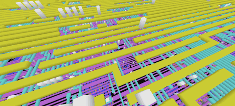</a>
  <br>
  <sub>Wires of the Almurut II chip. A click opens the whole layout in 3D.</sub>
</p>

The chip is in its own repository, [ttsky26e-almurut2](https://github.com/toksaitov/ttsky26e-almurut2), the project for the Tiny Tapeout shuttle TTSKY26e. Its build on GitHub makes the layout, checks it, and tests the gates. The layout opens in a browser in 3D, in the [Explorer](https://gds-explorer.tinytapeout.com/viewer?file=https://toksaitov.github.io/ttsky26e-almurut2/tinytapeout.oas&pdk=sky130A) and the [3D viewer](https://gds-viewer.tinytapeout.com/?model=https://toksaitov.github.io/ttsky26e-almurut2/tinytapeout.oas&pdk=sky130A) of Tiny Tapeout, and the [datasheet page](https://github.com/toksaitov/ttsky26e-almurut2/blob/main/docs/info.md) tells how the chip works and how to test it.

| Measure | Value |
| --- | --- |
| Process | SKY130, the open 130 nm process of SkyWater |
| Size | 16 tiles (8x2), 1,378 by 226 micrometers |
| Logic | 11,243 cells after synthesis, 2,791 of them flip-flops |
| Layout | 53,786 cells placed with the fill, 63 % of the area used, 0.92 m of wire |
| Clock | 12.5 MHz on the shuttle; the longest path takes 13.5 ns in the typical corner |
| Source | 3,826 lines of SystemVerilog in 18 files |
| Checks | Design rules, layout against circuit, and antenna rules without an error; 17 of 17 checks of the Tiny Tapeout precheck |

<p align="center">
  <picture>
    <source media="(prefers-color-scheme: dark)" srcset="asc2-pictures/cells-dark.svg">
    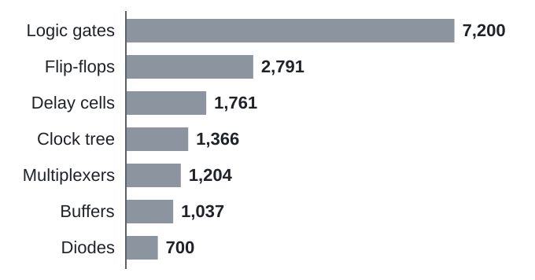
  </picture>
</p>

The layout has 16,059 cells without the fill, as its build counted them. Synthesis asked for 11,243; the tools of the layout added the rest: the tree that carries the clock to every flip-flop, buffers for long wires, delay cells, and diodes that protect the gates while the chip is made.

The CPU is a state machine that finishes one instruction before the next one starts, with one adder, as the multi-cycle processor of a textbook. The four cells of the accelerator multiply one bit of a factor in a clock, and the three rows pass through them in turn, which is how twelve weights fit beside a whole CPU. [asc2-kb/cpu-design.md](asc2-kb/cpu-design.md) tells how the hardware is built and why.

## The Bus

<p align="center">
  <picture>
    <source media="(prefers-color-scheme: dark)" srcset="asc2-pictures/bus-dark.svg">
    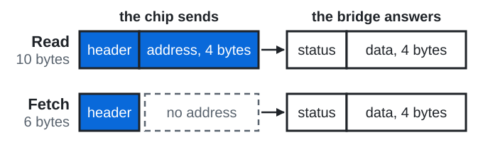
  </picture>
</p>

The chip and the bridge talk over eight data wires, a byte at a time, with a strobe from each side. A request is a header byte, four address bytes, and the data of a write; the answer is a status byte and the data of a read. The bridge remembers where the last fetch was, so the fetch of the next instruction goes without an address, and a loop that fits the instruction cache fetches nothing at all.

The bus was made so that a disturbance costs a repeat, never a hang or a wrong value. The chip checks every answer, waits a fixed time for a missing one, and sends the request again; a sequence bit lets the bridge see a repeat and answer it from a copy, so every access happens once. On the bench a four-hour run was clean, and 58,387 faults forced on purpose each cost one repeat and no error. Every rule on the bridge's side is firmware and can change after the chip is made. [asc2-kb/bus-protocol-v1.md](asc2-kb/bus-protocol-v1.md) has the rules.

## The Software

<p align="center">
  <picture>
    <source media="(prefers-color-scheme: dark)" srcset="asc2-pictures/platform-dark.svg">
    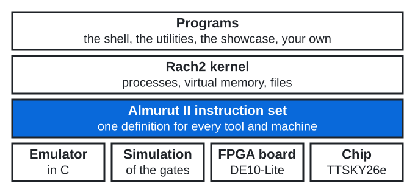
  </picture>
</p>

The same programs run on four machines: the emulator, the chip in simulation, the chip in an FPGA, and the chip of the shuttle. The emulator is the reference. Its header [asc2-emulated/asc.h](asc2-emulated/asc.h) defines the machine once, and the assembler, the tests, and the hardware all follow it.

**The emulator**, [asc2-emulated/](asc2-emulated), is the whole machine in C, the chip and the bridge together. It shows the registers, the translations, the devices, the console, and the memory, and runs one instruction at a time on request.

<p align="center">
  <picture>
    <source media="(prefers-color-scheme: dark)" srcset="asc2-pictures/emulator-dark.svg">
    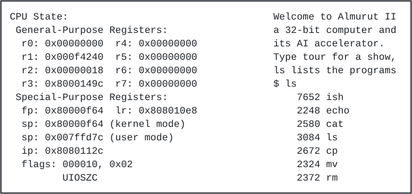
  </picture>
  <br>
  <sub>The top left part of the emulator's screen: the registers, and the console after <code>ls</code> at the shell.</sub>
</p>

**The assembler**, [asc2-assembler/](asc2-assembler), writes firmware images for the boot ROM and ELF32 object files for the linker. It takes the encodings from the header of the emulator, so the two cannot disagree about an instruction.

**The C compiler**, [asc2-tcc/](asc2-tcc), is TinyCC with a code generator for the machine and a small runtime library. The kernel, the shell, the utilities, and the showcase are written in C and built with it.

**The kernel Rach2**, [asc2-rach2/](asc2-rach2), runs programs as processes, each with its own memory behind page tables, and the timer shares the CPU between them. It has `fork` and `execve`, a file system on the disk, system calls with the numbers of Linux, the shell `ish` with redirection, and eight utilities: `echo`, `cat`, `ls`, `cp`, `mv`, `rm`, `touch`, and the line editor `ed`.

## How It Is Checked

Every layer is checked against the one below it, down to the gates of the layout. The checks, from the emulator to the board:

* 36 assembly programs, each of which explains a part of the machine in its comments and then checks it, 11 C programs whose output must equal that of the same program on the computer that runs the tests, and four programs that run the accelerator for millions of instructions against a model in Python.
* Seven sessions of the kernel: the shell, the utilities, the editor, programs that check the kernel from the side of a process, the showcase, and `tour`, with the console and the screen compared to the expected ones.
* The chip in simulation runs the same programs and the kernel, and every instruction is compared with the emulator, also with slow and lost answers of the bridge.
* The gates that the official layout run has made run the test of the chip with eight sets of start values in the flip-flops, and the start on both versions of the demo board.
* The tests themselves are tested: mistakes are planted one at a time to see a test fail. Of 105 planted in the hardware of the accelerator and 25 in its rules in the emulator, the tests caught every one that changes a result.
* On the bench, `make board-suite` runs the programs and the sessions of the kernel on the chip in the FPGA and compares what they print, and the frame on the display, with the emulator.

[asc2-tests/Readme.md](asc2-tests/Readme.md) describes the suites and tells how to add a program. [asc2-tests/Coverage.md](asc2-tests/Coverage.md) lists what each program checks.

## Building

The emulator, the assembler, the compiler, the kernel, and the tests need Make (GNU Make preferred), a C compiler with C11 support, ncurses 6, and `tar` with bzip2 and `patch` for the C compiler. On Ubuntu or Debian:

```bash
sudo apt-get update
sudo apt-get install -y make gcc libncurses-dev bzip2 patch
```

On macOS with Homebrew:

```bash
brew install make gcc ncurses
```

Each part builds with `make` in its directory, from the root of the platform:

```bash
make -C asc2-emulated     # the emulator:   asc2-emulated/asc [-p] [-k] [-d disk_file] path_to_binary
make -C asc2-assembler    # the assembler:  asc2-assembler/asa path_to_assembly output_file
make -C asc2-tcc          # the C compiler: asc2-tcc/build/tcc
make -C asc2-rach2        # the kernel and its disk: asc2-rach2/build/rach2.bin and disk.img
make -C asc2-tests        # the four suites on the emulator
```

A first program in assembly, [asc2-firmware/hello.s](asc2-firmware/hello.s), prints a greeting and then prints back what is typed:

```bash
./asc2-assembler/asa ./asc2-firmware/hello.s ./asc2-firmware/hello
./asc2-emulated/asc ./asc2-firmware/hello
```

The builds that need the hardware description of the chip read it from a clone of the chip's repository beside this one. These are the FPGA build, the checks for Tiny Tapeout, the suite on the simulated chip, and the pin check of the bridge:

```bash
git clone https://github.com/toksaitov/asc2-project
git clone https://github.com/toksaitov/ttsky26e-almurut2
cd asc2-project/asc2-tests/chip && make
```

A clone in another place is named on the command line of `make` with an absolute path, `CHIP_DIR=/path/to/ttsky26e-almurut2`; [chip.mk](chip.mk) has the rule. The suite on the simulated chip needs Verilator 5 and takes about fifteen minutes; some checks also need Icarus Verilog 13, `sv2v`, and Yosys, and the firmware of the bridge needs the Pico SDK and the Arm GCC toolchain. The Readme of each part names what it needs.

## The Boards

On the demo board of Tiny Tapeout the RP2350B of the board runs the firmware of the bridge, built for the board as [asc2-bridge/Readme.md](asc2-bridge/Readme.md) tells. On the bench the chip is in the FPGA of a DE10-Lite board ([asc2-targets/de10-lite/](asc2-targets/de10-lite)), and a Raspberry Pi Pico on jumper wires runs the firmware for the RP2040. On both, one command loads a program and is its terminal:

```bash
python3 -I asc2-bridge/host/bridge.py run asc2-firmware/hello
```

The demo board alone runs the whole computer, with a computer on its USB port as the terminal. An OLED screen of 128 by 64 pixels and a push button add the graphics, the games, and the stepper. On the bench, `make install` in [asc2-rach2/](asc2-rach2) puts the kernel and its disk into the flash of the Pico, so the machine boots to the shell at every power-up.

## The Platform

This repository is the platform of the computer, everything that runs on the chip and around it:

* [asc2-emulated/](asc2-emulated): the emulator of the whole machine in C, the reference for every other implementation
* [asc2-assembler/](asc2-assembler): the assembler
* [asc2-tcc/](asc2-tcc): the C compiler, TinyCC with a code generator for the machine
* [asc2-rach2/](asc2-rach2): the kernel Rach2, its shell, and its utilities
* [asc2-demos/](asc2-demos): the showcase
* [asc2-bridge/](asc2-bridge): the firmware of the bridge for the RP2350B of the demo board and for the RP2040 of the bench, the script that loads a program and is its terminal, and the memory test of the bus
* [asc2-targets/](asc2-targets): the chip on the DE10-Lite, and the checks of the chip for Tiny Tapeout with the layout run and the tests on the gates
* [asc2-tests/](asc2-tests): the tests on the emulator, on the simulated chip, and on the board
* [asc2-tools/](asc2-tools): the emulator without a screen, and the tools for firmware and disk images
* [asc2-firmware/](asc2-firmware): an example program for the bare machine
* [asc2-pictures/](asc2-pictures): the pictures of this page and the scripts that make them
* [asc2-kb/](asc2-kb): the notes of the design

New to the project? Read this page first, then [asc2-emulated/Readme.md](asc2-emulated/Readme.md) for a map of the machine, [asc2-tcc/Readme.md](asc2-tcc/Readme.md) for the compiler and the calling convention, [asc2-rach2/Readme.md](asc2-rach2/Readme.md) for the kernel, and the Readme of the directory you work in. After a change, `make` in [asc2-tests/](asc2-tests) checks the machine, the compiler, and the kernel.

## License

Copyright 2026 Dmitrii Toksaitov

This project is provided for educational purposes under the GNU General Public License, version 2; its text is in [LICENSE](LICENSE). The compiler in [asc2-tcc/](asc2-tcc) keeps the license of TinyCC. The chip, in its own repository [ttsky26e-almurut2](https://github.com/toksaitov/ttsky26e-almurut2), is under the Apache License, version 2.0.
